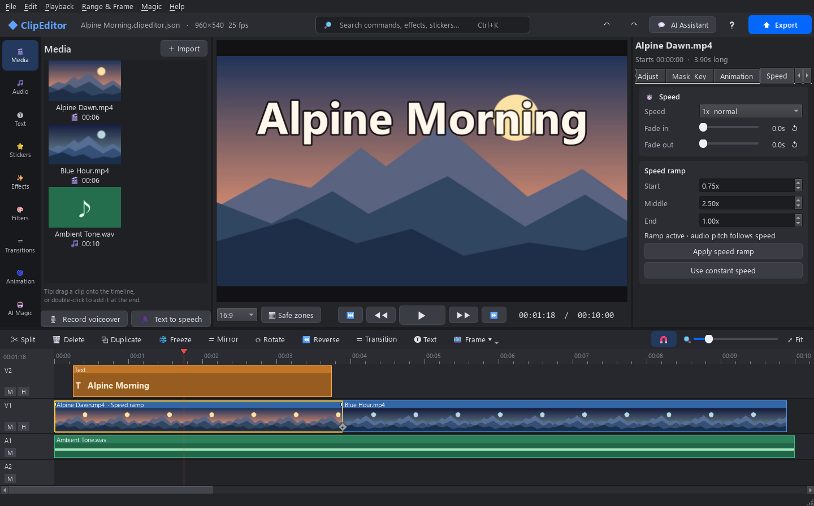

# ClipEditor

ClipEditor is a desktop video editor built with Python, PySide6, PyAV and FFmpeg and tested on Windows. It combines a multitrack timeline, live preview, effects, local AI tools and optional AI-agent controls.



## Run

Download the [Windows x64 ZIP](https://github.com/karuppusamym/DemoVideoEditor/releases/latest), extract it to a writable folder, and double-click **Launch ClipEditor.bat**. The ZIP includes Python. The first launch downloads pinned dependencies from PyPI into the extracted folder. After setup, basic editing and export work offline.

### Run from source

On Windows with Python 3.13, clone the repository and install the dependencies in a virtual environment.

```powershell
git clone https://github.com/karuppusamym/DemoVideoEditor.git
cd DemoVideoEditor
py -3.13 -m venv .venv
.\.venv\Scripts\python.exe -m pip install -r requirements.txt
.\run.bat
```

Drag a media file into the editor to import it. You can also pass your own media files to the launcher.

```powershell
.\run.bat "C:\path\to\your-video.mp4"
```

Open a saved project by passing its `.clipeditor.json` file. To export from the command line, run the following command.

```powershell
.\run.bat export project.clipeditor.json out.mp4 --crf 20
```

### Make your first edit

1. Import one or more clips with **File → Import media**, then drag a clip from the media bin to the timeline.
2. Select the clip, move the playhead, and press **S** to split it. Select a segment and press **Delete** to remove it.
3. Save your project with **Ctrl+S**, then use **Ctrl+E** to export an MP4.

Keep a project file and its media in the same folder tree to move them together. If source files are elsewhere and have moved, use **File → Locate missing media** and select their new folder. ClipEditor matches files by name and checks they can cover the existing edits.

## Workspace

- **Left panel:** Media, Audio, Text, Stickers, Effects, Filters, Transitions, Animation and AI Magic. Effect and filter cards preview on the current frame.
- **Center:** video preview and multitrack timeline.
- **Right inspector:** Text, Shape, Video, Adjust, Mask & Key, Animation, Keyframes, Speed and Audio tabs. Animatable controls have keyframe buttons.
- **Timeline toolbar:** split, delete, duplicate, freeze, mirror, rotate, reverse, transition, text, frame tools and zoom.

The editor also includes undo/redo, range editing, autosave and crash recovery, drag-and-drop import, proxy generation for high-resolution media, and a Ctrl+K command palette.

## Editing and effects

- Edit and arrange clips across multiple tracks; trim, split, move, duplicate, copy/paste, ripple-delete and detach audio.
- Add titles, shapes and emoji stickers. The galleries include 46 shape and emoji presets.
- Use 32 video effects, 14 filter looks and 6 transitions. Masks, chroma key, 13 blend modes, crop, flip and rotation are also available.
- Animate position, scale, rotation, opacity and volume with keyframes and easing. There are 42 in, out and loop animation presets.
- Open **Keyframes** to edit an animation curve. Double-click to add a point, drag a diamond to change its time and value, or select a diamond and enter exact values. Choose outgoing easing to control the segment to the next point. Copy and paste a curve between clips to fit the same animation to a different duration.
- Adjust colour, speed, fades and audio. In the **Speed** tab, set start, middle, and end speeds and click **Apply speed ramp**. Ramp audio follows the speed and changes pitch. Constant speed keeps pitch.
- The built-in library contains 28 sound effects and 20 voice/music effects. Voiceover recording and offline text-to-speech are included.
- Enable social safe-zone guides for TikTok/Reels framing.

## AI tools

Local tools include Whisper auto-captions, silence removal, background removal, reverse, stabilization, noise removal, enhancement/upscaling, smooth slow motion and automatic 9:16 reframing. Availability and processing time depend on optional models and local hardware.

The in-app chat assistant uses Claude when `ANTHROPIC_API_KEY` is set or you supply a key in the app. Without a key it runs the built-in offline helper. When using Claude, prompts and editing-tool results are sent to Anthropic. Background removal requires the optional `rembg[cpu]` package and downloads a model on first use. Whisper captions also download a model on first use.

## Export

Export H.264, HEVC or AV1 at up to 4K and 60 fps, with optional 10-bit output. Compatible Intel, NVIDIA or AMD hardware encoders are detected for accelerated export; software encoding remains available.

## AI-agent interface

Run the Model Context Protocol (MCP) server with:

```powershell
.\.venv\Scripts\python.exe -m clipeditor mcp
```

Configure your MCP client to launch that command from the repository directory. Project edits remain in memory until saved.

## Project layout

```text
clipeditor/
  model.py       Project, track, clip and media-asset data
  editor.py      Editing operations and undo/redo
  media.py       Media probing, decoding, waveforms and thumbnails
  render.py      Preview and frame compositor
  export.py      FFmpeg export
  api.py         Shared editing API for the assistant and MCP server
  ui/            PySide6 editor interface
  ai/            Assistant and local AI tools
tests/           pytest suite
```

## Contributing

Fork the repository to make changes and open a pull request. See the [contributing guide](CONTRIBUTING.md) for setup and testing, the [code of conduct](CODE_OF_CONDUCT.md) for community expectations, and the [security policy](SECURITY.md) for private vulnerability reporting.

ClipEditor source code is available under the [MIT License](LICENSE).

## Known gaps

ClipEditor does not yet include multiple timelines per project, voice cloning, mobile apps or translations. See [COMPARISON.md](COMPARISON.md) for a feature comparison and the current roadmap.
